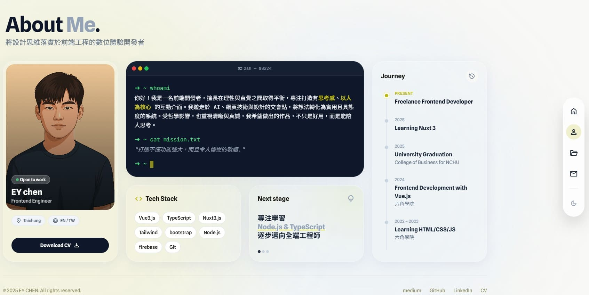

# MyWeb - Full-Stack Engineer Portfolio


這是一個基於 **Nuxt 3** 與 **Vue 3 (Composition API)** 開發的全端工程師個人網站/作品集 (Portfolio)。

## 🛠 核心技術棧 (Tech Stack)

本專案採用以下現代化前端技術進行開發：

- **核心框架**: [Nuxt 3](https://nuxt.com/) (Vue 3 + Composition API)
- **UI 與樣式**: [Tailwind CSS](https://tailwindcss.com/)
- **輪播組件**: [Nuxt Swiper](https://nuxt.com/modules/swiper) (`swiper`)
- **實用工具庫**: [VueUse](https://vueuse.org/) (`@vueuse/nuxt`, `@vueuse/core`)
- **圖標與字體**:
  - [Lucide Vue Next](https://lucide.dev/) (向量圖標)
  - Google Fonts (Spline Sans, JetBrains Mono)
  - Material Symbols Outlined

## 📂 專案結構 (Project Structure)

- `nuxt.config.ts`：專案進入點與核心配置 (模組、字體、SEO Meta 等)。
- `tailwind.config.ts`：Tailwind CSS 的自訂義主題與設計系統 (Design System) 設置。
- `assets/css/main.css`：全域 Tailwind 樣式檔。
- `mock/`：模擬數據或假資料，用於本地開發與測試。
- `app/`：Nuxt 核心應用邏輯與元件放置區。

## 🚀 本地開發與執行 (Setup & Development)

請先確保您的開發環境已安裝 **Node.js (建議 v18 以上)**。

1. **安裝專案依賴**

   ```bash
   npm install
   ```

2. **啟動開發伺服器** (預設運行於 `http://localhost:3000`)

   ```bash
   npm run dev
   ```

3. **專案打包與生產環境預覽**
   ```bash
   npm run build
   npm run preview
   ```

## 💡 開發約定與前端最佳實務

- **優先使用 Composition API**：撰寫 Vue 元件時應全程使用 `<script setup>` 語法糖。
- **避免多餘的樣式封裝**：統一透過 Tailwind CSS Utility-first 進行排版，減少使用 `<style scoped>` 以維持樣式的全域一致性。
- **善用 Composables**：若需處理視窗大小、滾動狀態、或者本機存儲 (Local Storage) 等，請優先調用 `VueUse` 提供的 API，避免重複造輪子。
- **效能考量**：在實作 Swiper 或是引入多個圖標時，請留意 Client-Side 渲染瓶頸，針對非首屏必要元素可以利用 Nuxt 的 `<ClientOnly>` 或懶加載策略來提升 LCP (Largest Contentful Paint) 表現。
